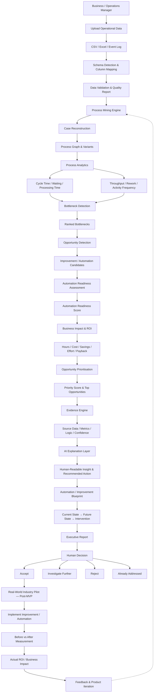

# ProcessLens — End-to-End Product Workflow

## 1. Product Overview

**ProcessLens** is a decision-support platform designed to help SMEs understand where operational time and money are being lost, quantify the impact, and prioritise which process improvements or automation opportunities should be addressed first.

### Core Product Loop

**Discover → Quantify → Prioritise → Act**

At its simplest:

**Operational Data → Evidence → Economics → Decision**

---

## 2. End-to-End Workflow

---

## 3. Workflow Stage Details

### Stage 1 — Data Ingestion

**Purpose:** Bring operational process data into ProcessLens.

**Initial inputs:** CSV, Excel, event logs.

**Future inputs:** ERP systems, APIs, databases, and other operational systems.

### Stage 2 — Data Validation & Quality

ProcessLens detects the schema, identifies likely case/activity/timestamp/resource fields, allows manual mapping, validates required fields, detects missing or invalid data, and generates a data-quality report.

### Stage 3 — Process Discovery

The system reconstructs individual cases, orders activities chronologically, generates a process graph, identifies common variants, and preserves event-level evidence.

### Stage 4 — Process Analytics

Core metrics include cycle time, waiting time, processing time, throughput, rework rate, activity frequency, and process variants. The analytics layer should be deterministic and reproducible.

### Stage 5 — Bottleneck Detection

Potential signals include time impact, waiting impact, volume impact, rework impact, process variation, and resource concentration. Output: **Ranked Bottlenecks**.

### Stage 6 — Improvement & Automation Opportunity Detection

Potential signals include frequency, manual effort, rule-based work, exception rate, and business impact. Output: **Opportunity Candidates**.

### Stage 7 — Automation Readiness Assessment

Assessment factors include repetitiveness, rule-based nature, digital inputs, volume, exception rate, human judgment, and operational risk. Output: **Automation Readiness Score**.

### Stage 8 — Business Impact & ROI

Potential calculations include manual hours, estimated labour cost, potential annual saving, implementation effort/cost, and estimated payback. Calculations should use verified inputs and explicit assumptions.

### Stage 9 — Opportunity Prioritisation

The core question is:

> **What should the business fix or automate first?**

Potential factors: business impact, automation readiness, implementation effort, payback, and risk.

### Stage 10 — Evidence & Explainability

Every important recommendation should be traceable to source data, calculated metrics, calculation logic, and confidence level.

### Stage 11 — AI Explanation Layer

Architecture principle:

**Deterministic Analytics → Verified Results → LLM → Explanation**

The LLM explains verified results. It should not invent operational metrics, ROI, savings, process times, scores, or source evidence.

### Stage 12 — Automation / Improvement Blueprint

Structure: current-state process → improvement point → future-state process → suggested intervention → possible technologies → human-in-the-loop requirements.

### Stage 13 — Executive Report

The report provides process health, top opportunities, business impact, evidence, recommended actions, and the automation/improvement blueprint.

### Stage 14 — Human Decision

Possible decisions: **Accept**, **Investigate Further**, **Reject**, or **Already Addressed**.

### Stage 15 — Real-World Industry Pilot — Post-MVP

**Real Business Data → Improvement → Automation / Process Change → Before/After Measurement → Actual ROI → Feedback → Product Iteration**

This stage is intentionally outside the initial MVP boundary.

---

## 4. Core Product Architecture Principle

ProcessLens should separate analytical computation from generative explanation.

### Deterministic Layer

Responsible for data validation, process reconstruction, process metrics, bottleneck detection, opportunity detection, automation readiness, ROI calculations, prioritisation, and evidence generation.

### AI Layer

Responsible for explaining verified findings, summarising insights, translating analytical output into business language, generating recommended actions, and producing an improvement/automation blueprint.

> **The AI explains the evidence; it does not create the evidence.**

---

## 5. Product Decision Loop

The entire product should support one management decision:

> **What should we improve or automate first, why, and what business value could it create?**

**Discover → Quantify → Prioritise → Act**

Evidence chain:

**Operational Data → Process Understanding → Problem Detection → Financial Quantification → Prioritisation → Recommendation → Decision → Impact Measurement**

---

## 6. MVP Boundary

The initial MVP focuses on:

**Data Ingestion → Validation → Process Discovery → Process Analytics → Bottleneck Detection → Opportunity Detection → Automation Readiness → Business Impact → Prioritisation → Evidence → AI Explanation → Blueprint → Executive Report**

Post-MVP capabilities include live ERP/API integrations, automated workflow deployment, autonomous process execution, continuous production monitoring, real-world industry implementation, and large-scale before/after measurement.

---

## 7. Important Product Constraint

ProcessLens should not be positioned simply as:

> “Upload a CSV and AI finds bottlenecks.”

The intended product proposition is:

> **ProcessLens helps businesses discover where operational time and money are being lost, prove it with evidence, and prioritise what should be improved or automated first.**

The key transition is:

**What is happening? → What should we do about it?**

---

## 8. Product Output

For each high-priority opportunity, ProcessLens should ideally produce:

- Opportunity name
- Process / activity affected
- Evidence
- Key metrics
- Business impact
- Automation readiness
- Implementation effort
- Estimated payback
- Priority score
- Confidence
- Recommended action
- Future-state / automation blueprint

This is the core unit of value produced by ProcessLens.

---

## 9. End State

**Operational Data → Process Understanding → Problem Detection → Financial Quantification → Opportunity Prioritisation → Improvement Recommendation → Automation / Process Change → Impact Measurement → Continuous Product Improvement**

The MVP proves the decision-support loop. The industry pilot proves whether the recommendations create measurable real-world value.
